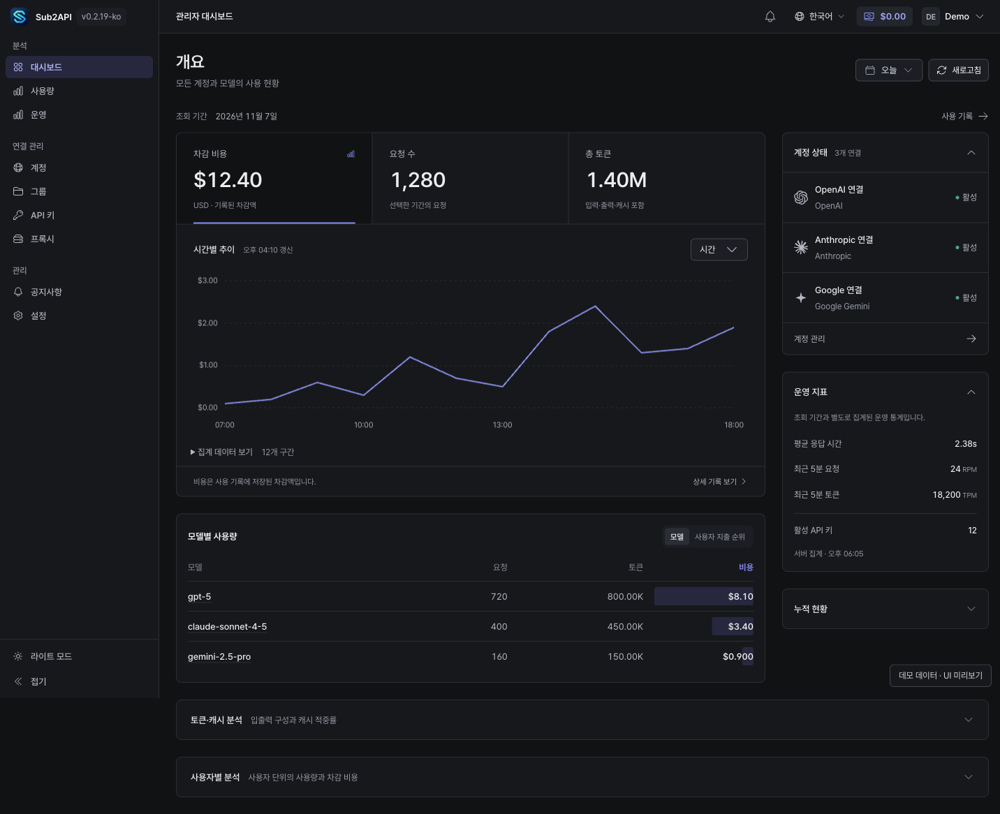
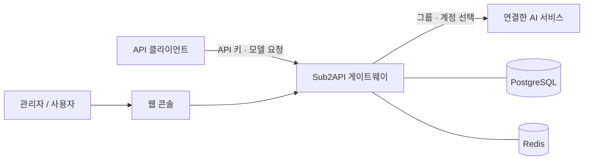

<div align="center">


# Sub2API

**AI 계정과 API 사용량을 한곳에서 관리하는 셀프 호스팅 게이트웨이**

한국어로 다듬은 관리 화면 · Pretendard · 라이트 / 다크 테마

[시작하기](#시작하기) · [개발하기](#개발하기) · [문서](#문서) · [업스트림](https://github.com/Wei-Shaw/sub2api)

</div>

---

Sub2API는 연결한 AI 서비스 계정으로 요청을 전달하고, 사용자별 API 키와 라우팅 그룹, 사용량을 관리하는 오픈 소스 프로젝트입니다. 관리자는 계정 연결 상태와 요청 기록을 확인하고, 사용자는 발급받은 API 키로 게이트웨이에 접근합니다.

이 저장소는 [Wei-Shaw/sub2api](https://github.com/Wei-Shaw/sub2api)의 **한국어 UI 포크**입니다. 기본 기능을 바탕으로 한국어 표현과 화면의 정보 밀도, 표·차트의 가독성, 밝고 어두운 테마를 다듬습니다. 한국어 UI 소스는 `ui/korean-redesign` 브랜치에서 관리합니다.



<p align="center"><sub>실제 UI를 데모 데이터로 렌더링한 미리보기입니다. 운영 계정과 개인 사용량은 포함하지 않았습니다.</sub></p>

> **사용 전 확인**
> 업스트림 제공자의 약관에 따라 계정 공유·구독 할당량 중계 등의 사용이 제한될 수 있습니다. 각 제공자의 약관과 적용 법규를 먼저 확인하세요. 프로젝트는 기술 학습·연구 목적으로 제공되며, 제3자 서비스의 운영이나 상업 활동을 승인하거나 보증하지 않습니다. [이용 관련 고지](#이용-관련-고지)를 읽어주세요.

## 할 수 있는 일

| 영역 | 주요 기능 |
| --- | --- |
| 계정 연결 | OAuth·API 키 기반 계정 등록, 연결 상태와 지원되는 할당량 확인 |
| API 키 관리 | 사용자별 키 발급, 그룹 연결, 키별 사용량 확인 |
| 요청 라우팅 | 그룹과 모델 설정에 따른 계정 선택, 세션 유지, 동시 요청 제어 |
| 사용량 분석 | 요청·토큰·비용 기록, 기간별 추이와 모델별 사용량 확인 |
| 운영 관리 | 사용자·그룹·설정 관리, 선택적으로 구독·결제 기능 구성 |

실제로 사용할 수 있는 모델과 요청 형식은 **연결한 계정, 제공자, 그룹 설정**에 따라 달라집니다. 연결 정보와 API 키를 별도로 준비해야 합니다. 프로토콜별 진입점은 [게이트웨이 라우트](backend/internal/server/routes/gateway.go), 복합 그룹의 모델 선택 규칙은 [운영 가이드](docs/COMPOSITE_GROUPS.md)를 참고하세요.

### 한국어로 편하게 운영하기

- **독립적인 한국어 UI**: 브라우저 번역 없이 한국어를 제공하며, 영어·중국어로도 전환할 수 있습니다.
- **한글에 맞춘 서체와 숫자**: Pretendard Variable을 자체 호스팅하고, 비교가 필요한 수치에는 고정폭 숫자를 사용합니다.
- **사용량에서 원인까지**: 비용·요청·토큰을 선택하면 추이와 모델별 정렬이 함께 바뀝니다. 모델을 눌러 해당 기간의 요청 기록으로 이동하고, 뒤로 가면 조회 조건이 복원됩니다.
- **차분한 작업 화면**: 분석·연결 관리·관리로 탐색 메뉴를 묶고, 세부 분석은 필요할 때 펼쳐볼 수 있습니다.
- **두 가지 테마**: 화면과 표, 차트에 라이트·다크 테마를 함께 적용합니다.

언어 설정은 [i18n](frontend/src/i18n/index.ts), 서체와 공통 스타일은 [style.css](frontend/src/style.css)에 있습니다. 색상·서체·컴포넌트 기준은 [DESIGN.md](DESIGN.md)에 정리했습니다.

## 동작 구조



프런트엔드는 Vue 3·TypeScript·Vite·Tailwind CSS, 백엔드는 Go·Gin·Ent로 구성됩니다. 기본 Compose 구성은 앱·PostgreSQL·Redis를 실행합니다. 배포용 빌드는 프런트엔드를 Go 바이너리에 포함합니다. [프런트엔드 의존성](frontend/package.json) · [백엔드 의존성](backend/go.mod) · [Dockerfile](Dockerfile) · [Compose 구성](deploy/docker-compose.local.yml)

## 시작하기

아래는 **새 설치**에서 한국어 UI를 직접 빌드하는 방법입니다. Docker Engine 또는 Docker Desktop과 Compose 플러그인, Git이 필요합니다. 기존 설치는 [업데이트와 복구](#업데이트와-복구)를 먼저 확인하세요.

### 1. 소스와 이미지 준비

```sh
git clone --branch ui/korean-redesign https://github.com/YangTaeyoung/sub2api.git
cd sub2api

docker build \
  --build-arg VERSION=ko-local \
  --build-arg COMMIT="$(git rev-parse HEAD)" \
  -t sub2api-korean:local .
```

`ko-local`은 이 예시의 로컬 빌드 표시입니다. 기본 배포 파일은 업스트림의 `weishaw/sub2api:latest` 이미지를 사용하므로, 한국어 UI를 적용하려면 방금 빌드한 이미지를 선택해야 합니다. [빌드 정의](Dockerfile) · [기본 이미지 설정](deploy/docker-compose.local.yml)

### 2. 환경 설정

```sh
cd deploy
cp .env.example .env
mkdir -p data postgres_data redis_data

# 각각 실행해 서로 다른 비밀값을 생성한 뒤 .env에 입력하세요.
openssl rand -hex 32
openssl rand -hex 32
openssl rand -hex 32
```

`.env`에서 다음 값을 설정합니다. 전체 항목과 설명은 [환경 설정 예시](deploy/.env.example)를 참고하세요.

| 변수 | 설정 안내 |
| --- | --- |
| `POSTGRES_PASSWORD` | 생성한 데이터베이스 비밀번호로 교체 |
| `JWT_SECRET` | 로그인 토큰 서명에 사용할 고정 비밀값 |
| `TOTP_ENCRYPTION_KEY` | 2단계 인증 정보 암호화에 사용할 고정 비밀값 |
| `TZ` | 한국 시간 기준으로 운영하려면 `Asia/Seoul` |
| `BIND_HOST` | 로컬 접근으로 시작하려면 `127.0.0.1` |
| `ADMIN_EMAIL`, `ADMIN_PASSWORD` | 초기 관리자 로그인 정보. 비워두면 첫 시작 시 생성되어 로그에 표시됨 |

비밀값과 초기 관리자 정보가 담긴 `.env`·로그는 공개하지 마세요. JWT·TOTP 키는 재시작과 업데이트 후에도 유지해야 합니다. 외부에 공개할 때는 HTTPS와 프록시·접근 정책을 구성하세요. [환경 변수 설명](deploy/docker-compose.local.yml) · [프록시와 보안 설정](deploy/EDGE_SECURITY.md)

### 3. 한국어 이미지로 실행

`deploy/docker-compose.override.yml`을 다음 내용으로 만듭니다.

```yaml
services:
  sub2api:
    image: sub2api-korean:local
```

`deploy` 디렉터리에서 두 파일을 함께 지정해 실행합니다.

```sh
# 병합된 설정의 유효성 확인
docker compose -f docker-compose.local.yml -f docker-compose.override.yml config --quiet

# 앱, PostgreSQL, Redis 시작
docker compose -f docker-compose.local.yml -f docker-compose.override.yml up -d

# 상태와 초기 관리자 정보 확인
docker compose -f docker-compose.local.yml -f docker-compose.override.yml ps
docker compose -f docker-compose.local.yml -f docker-compose.override.yml logs --tail=100 sub2api
```

기본 포트는 `8080`입니다. 브라우저에서 [http://localhost:8080](http://localhost:8080)에 접속해 로그인한 뒤 계정·그룹·API 키를 설정합니다. Docker 구성은 `AUTO_SETUP=true`로 초기 설정을 진행합니다. Compose 파일은 지정한 순서로 병합되며, 뒤의 `image` 값이 앞의 값을 대체합니다. [초기 설정 코드](backend/internal/setup/setup.go) · [Docker 공식 병합 가이드](https://docs.docker.com/compose/how-tos/multiple-compose-files/merge/)

## 업데이트와 복구

**기존 설치는 사용 중인 `.env`, Compose 프로젝트, 설정·데이터 경로와 볼륨을 유지하세요.** 새 설치 예시를 기존 환경 위에 그대로 실행하지 마세요.

1. 현재 이미지 태그·다이제스트와 소스 리비전을 기록합니다. PostgreSQL 덤프, 앱 설정·데이터, Compose·환경 파일을 백업하고 복원 가능 여부를 확인합니다.
2. 변경 사항과 마이그레이션을 검토한 뒤 새 태그로 포크 이미지를 빌드합니다. 사용 중인 기본 Compose 파일에 맞춰 override의 앱 이미지 항목만 바꿉니다.
3. 병합된 설정을 검토하고 앱 서비스만 재생성합니다. 위의 파일 구성을 사용한다면 다음과 같습니다.

```sh
# 데이터베이스와 Redis가 이미 실행 중인 기존 환경에서 사용
docker compose -f docker-compose.local.yml -f docker-compose.override.yml up -d --no-deps sub2api
```

로그·헬스 체크·관리자 로그인·기존 API 요청을 확인합니다. 되돌릴 때는 이전 이미지를 선택하고 앱 서비스를 다시 생성합니다. 데이터베이스 변경이 포함된 업데이트는 이미지 교체만으로 되돌리지 말고, 해당 버전의 복구 절차와 백업을 사용하세요. 볼륨을 삭제하는 `down -v` 명령은 업데이트 과정에서 사용하지 않습니다. [Docker의 서비스 재생성 동작](https://docs.docker.com/reference/cli/docker/compose/up/) · [데이터베이스 마이그레이션 안내](deploy/README.md#database-migration-notes-postgresql)

업스트림 변경을 가져올 때는 별도 브랜치에서 검토·병합하고 포크 이미지를 다시 빌드합니다. 업스트림 이미지로 교체하면 이 포크의 UI 변경은 포함되지 않습니다.

## 개발하기

소스의 기준 버전은 [backend/go.mod](backend/go.mod)와 [Dockerfile](Dockerfile)을 따릅니다. 현재 빌드 구성은 **Go 1.27.3, Node.js 24, pnpm 9**를 사용합니다. 로컬 백엔드 실행에는 PostgreSQL과 Redis도 필요합니다.

### 프런트엔드

저장소 루트에서 실행합니다.

```sh
cd frontend
npx --yes pnpm@9 install --frozen-lockfile
npx --yes pnpm@9 dev
```

개발 서버는 기본 `http://localhost:3000`, 백엔드 프록시 대상은 `http://localhost:8080`입니다. 다른 백엔드를 사용하려면 `VITE_DEV_PROXY_TARGET`을 설정합니다. [Vite 설정](frontend/vite.config.ts)

```sh
# frontend 디렉터리에서 실행
npx --yes pnpm@9 build
npx --yes pnpm@9 exec vitest run src/i18n/__tests__
npx --yes pnpm@9 lint:check
```

`build`는 번역 키 검사와 TypeScript 검사를 거쳐 `backend/internal/web/dist`에 산출물을 만듭니다. 명령 정의는 [package.json](frontend/package.json), 잠금 파일 설치 옵션은 [pnpm 공식 문서](https://pnpm.io/cli/install#--frozen-lockfile)를 참고하세요.

### 백엔드

별도 터미널에서 저장소 루트부터 실행합니다.

```sh
cd backend
go run ./cmd/server
```

바이너리로 새로 설치할 때는 초기 설정 화면에서 데이터베이스·Redis·관리자 계정을 구성합니다. **처음부터 `config.yaml`을 복사해 두면 설정 화면을 건너뜁니다.** 기존 설치의 설정 파일이나 설치 잠금 파일을 지워 초기화를 시도하지 마세요. [설정 화면 진입 조건](backend/internal/setup/setup.go#L163) · [상세 개발 안내](DEV_GUIDE.md)

프런트엔드 빌드를 완료한 뒤 웹 UI를 포함하는 바이너리가 필요하면 다음과 같이 빌드합니다.

```sh
# backend 디렉터리에서 실행
go build -tags embed -o sub2api ./cmd/server
```

백엔드 검증과 코드 생성 명령은 [backend/Makefile](backend/Makefile)에 있습니다. Ent 스키마를 수정했다면 생성 코드도 함께 갱신하세요.

```sh
go test -tags=unit ./...
go generate ./ent
go generate ./cmd/server
```

### 디렉터리 안내

```text
backend/                 Go 서버, 게이트웨이, 데이터 접근
  cmd/server/            서버 진입점
  internal/              핸들러, 서비스, 저장소, 웹 UI 임베드
  ent/                   데이터 스키마와 생성 코드
  migrations/            데이터베이스 마이그레이션
frontend/                Vue 웹 콘솔
  src/i18n/              한국어·영어·중국어 번역
  src/views/             관리자·사용자·인증 화면
  src/components/        공통 UI와 기능별 컴포넌트
deploy/                  Compose, 설정 예시, 배포 안내
docs/                    기능별 운영 문서와 법적 고지
```

## 운영 시 확인할 점

- **Nginx 헤더 설정**: Codex 등에서 사용하는 `session_id`처럼 밑줄이 포함된 헤더를 전달하려면 `http` 블록에 `underscores_in_headers on;`을 설정합니다. 기본값은 `off`입니다. [Nginx 공식 문서](https://nginx.org/en/docs/http/ngx_http_core_module.html#underscores_in_headers)
- **개인·내부 팀용 단순 모드**: `RUN_MODE=simple`로 활성화합니다. 과금 처리와 관련 UI가 달라지므로 사용 목적에 맞춰 선택하세요. 기본 그룹 자동 생성과 키 사용 한도 옵션은 [환경 설정 예시](deploy/.env.example)에 있습니다.
- **장시간 요청과 프록시**: SSE·WebSocket을 사용하는 경로의 제한과 신뢰할 프록시 설정을 확인하세요. [HTTP 진입점 보안 안내](deploy/EDGE_SECURITY.md)
- **비밀 정보 관리**: API 키, OAuth 토큰, DB 덤프, 운영 환경 파일과 개인 사용량 화면은 저장소에 넣지 않습니다.

## 문서

| 목적 | 문서 |
| --- | --- |
| 배포 방식·환경 변수·문제 해결 | [배포 가이드](deploy/README.md), [Docker 이미지](deploy/DOCKER.md), [Apple container](deploy/APPLE_CONTAINER.md) |
| 개발 환경과 코드 생성 | [개발 가이드](DEV_GUIDE.md) |
| UI 원칙과 구현 기준 | [디자인 시스템](DESIGN.md) |
| 계정·모델 라우팅 | [복합 그룹](docs/COMPOSITE_GROUPS.md) |
| 관리자 API 키 | [관리자 키와 접근 범위](docs/admin-api-keys.md) |
| 결제 구성 | [결제 가이드](docs/PAYMENT.md) |
| 비동기 이미지 생성·편집 | [비동기 이미지 작업](docs/ASYNC_IMAGE_TASKS.md) |
| 확장 기능 | [플러그인 개발](docs/PLUGIN_DEVELOPMENT.md) |
| 업스트림 전체 안내·제공자별 설정 | [영문 원본 README](https://github.com/Wei-Shaw/sub2api/blob/main/README.md), [中文](README_CN.md), [日本語](README_JA.md) |

업스트림 문서와 배포 스크립트는 업스트림 이미지·릴리스를 기준으로 설명합니다. 이 포크를 배포할 때는 위의 한국어 이미지 빌드와 선택 절차를 함께 적용하세요. 제공자별 OAuth와 고급 게이트웨이 설정은 해당 문서와 사용 중인 리비전의 설정 예시를 대조해 구성합니다.

## 이용 관련 고지

원본 프로젝트의 주요 고지를 아래에 옮겼습니다. 자세한 내용은 [배포·운영 준수 문서](docs/legal/admin-compliance.en.md)와 [원문](docs/legal/admin-compliance.zh.md)을 확인하세요.

- **제공자 약관**: 이 프로젝트의 사용이 Anthropic 등 업스트림 제공자의 이용약관에 위배될 수 있습니다. 사용 전에 관련 약관을 검토해야 하며, 사용에 따른 위험은 사용자에게 있습니다.
- **적법한 사용**: 사용자는 적용되는 국가·지역의 법률과 규정을 준수해야 합니다. 불법적인 목적으로 사용해서는 안 됩니다.
- **면책 고지**: 프로젝트는 기술 학습·연구 목적으로 제공됩니다. 원본 작성자는 사용에 따른 계정 정지, 서비스 중단, 데이터 손실 등 직·간접 손해에 책임을 지지 않는다고 고지합니다.
- **운영 주체의 책임**: 원본 개발자는 이 프로젝트를 기반으로 한 제3자의 상업 운영을 별도로 승인한 바 없다고 고지합니다. 프로젝트나 개발자의 공식 서비스·보증·제휴로 오인하게 해서는 안 되며, 해당 활동의 분쟁·손실·법적 책임은 운영 주체에게 있습니다.

이 고지는 [오픈 소스 라이선스](LICENSE), 업스트림 약관이나 적용 법률을 대체하지 않습니다.

## 원본과 라이선스

Sub2API의 원본은 [Wei-Shaw/sub2api](https://github.com/Wei-Shaw/sub2api)입니다. 원본 프로젝트와 기여자에게 감사드립니다. 업스트림의 후원·생태계 안내는 [원본 README](https://github.com/Wei-Shaw/sub2api/blob/main/README.md)에서 볼 수 있습니다.

프로젝트는 **GNU LGPL v3.0 이상**으로 배포됩니다. 원본 저작권 표기: Copyright (c) 2026 Wesley Liddick. 전체 조건은 [LICENSE](LICENSE), 기여 관련 안내는 [CLA.md](CLA.md)를 참고하세요.

서체는 [Pretendard](https://github.com/orioncactus/pretendard)이며, 함께 제공되는 [SIL Open Font License 1.1](frontend/public/fonts/pretendard/LICENSE)을 따릅니다. [서체 파일과 출처](frontend/public/fonts/pretendard/README.md)
